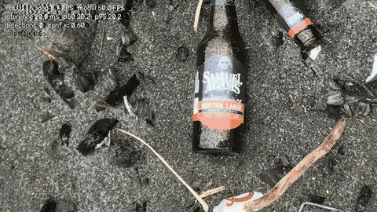

# Litter Detection: YOLO11n vs Faster R-CNN

Real-time litter detection on TACO, with an offline two-stage accuracy pass and a
single evaluation protocol for both models.



**Author:** Tong Yanhao (2024020313) · GitHub: [haodegaobai](https://github.com/haodegaobai)

This is a cleaned, standalone version of a final project for a speech and image
recognition course. The repository contains the data pipeline, both training
runs, the shared evaluation harness, the error analysis, the live demo, and the
trained YOLO weights.

---

## What this project does

- Folds TACO's 60 litter categories into **6 material superclasses**:
  plastic, paper/cardboard, metal, glass, cigarette, other.
- Fine-tunes **YOLO11n** and **Faster R-CNN (MobileNetV3-Large FPN)** on the same
  1500-image dataset and the same train/validation/test split.
- Evaluates both models with **one implementation** of COCO mAP
  (`torchmetrics`), the same 640 px input, the same NMS IoU, and the same timing
  protocol.
- Runs a live webcam/video pipeline with a deliberately constrained
  `--demo-safe` mode for classroom demonstrations.
- Quantifies where the errors are: small objects, background false positives,
  class confusion, and the accuracy/recall cost of the demo configuration.

The result is not a production litter detector. It is a reproducible comparison
of two detector families on a hard, long-tailed dataset, with the failure modes
measured rather than hidden.

---

## Measured results

Test split: **225 images / 764 instances**, seed 42, selected on validation only.

| Metric | YOLO11n | Faster R-CNN |
|---|---:|---:|
| mAP@0.5 | **0.1806** | 0.1615 |
| mAP@0.5:0.95 | **0.1344** | 0.0974 |
| mAP@0.75 | **0.1460** | 0.1078 |
| mAP small (<32 px) | **0.0551** | 0.0003 |
| Mean latency, 640 px, batch 1, FP32 | **12.34 ms** | 21.17 ms |
| Throughput | **81.0 FPS** | 47.2 FPS |
| Parameters | **2.61 M** | 18.98 M |
| Weight file | **5.5 MB** | 76.1 MB |

YOLO11n leads on every row. The margin is not uniform: it is +0.019 at IoU 0.5,
+0.037 on the averaged metric, and +0.072 on large objects. Small objects remain
the main weakness for both models.

The model-selection detail that matters: Faster R-CNN's first schedule peaked on
its first epoch and then declined, a sign that the learning rate was too large.
The reported schedule uses lr 0.0015 and 12 epochs, reaching validation
mAP@0.5 = 0.1668. The test row is that checkpoint's evaluation. YOLO11n was
allowed 100 epochs with early stopping; it peaked at epoch 56 and stopped at
epoch 76.

### Demo-safe configuration

The live demo does not run the research setting. `--demo-safe` raises confidence
to 0.60, keeps the three classes that trained, and applies geometric filters.
On the same test predictions, with the class set held fixed:

| Configuration | YOLO precision | YOLO recall | R-CNN precision | R-CNN recall |
|---|---:|---:|---:|---:|
| research, 3 classes, conf 0.25 | 0.5000 | 0.3922 | 0.4099 | 0.3420 |
| demo-safe, 3 classes, conf 0.60 | **0.6429** | 0.2745 | **0.7209** | 0.1351 |

The demo looks cleaner because it reports less. That trade is measured in
`runs/results/deploy_config.md`, not hidden.

### Error analysis

At confidence 0.25 and IoU 0.5:

| Model | TP | Background FP | Wrong class | Missed GT |
|---|---:|---:|---:|---:|
| YOLO11n | 190 | 162 | 109 | 574 |
| Faster R-CNN | 159 | 107 | 124 | 605 |

The two models fail differently: YOLO detects more and produces more background
boxes; Faster R-CNN is more conservative and misses more ground truth. Both are
dominated by small objects. At confidence 0.25, YOLO recalls 8.6% of objects
below 32 px; Faster R-CNN recalls 23.3%, but its small-object AP is still
near-zero because its detections are poorly ranked.

Some of the "background" false positives are real litter that TACO never
annotated. The 24 highest-scoring background detections were cropped and
inspected: 21 are visibly real litter. Precision on this test set is therefore
understated by an unknown amount. See `figures/fig_fp_sheet.png`.

### Domain shift

On 55 confirmed litter-free campus frames, every detection is a false positive,
so the metric is false positives per frame:

| Model | conf 0.25 | conf 0.40 | conf 0.55 | conf 0.70 |
|---|---:|---:|---:|---:|
| YOLO11n | **0.036** | 0.036 | 0.0 | 0.0 |
| Faster R-CNN | 0.236 | 0.073 | 0.036 | 0.0 |

The classroom failure that motivated `--demo-safe` was the model labelling
blackboard strokes as cigarettes. The negative-frame test measures that failure
mode without pretending it is an accuracy score: those frames have no boxes to
match against. A positive out-of-domain mAP would require hand-corrected boxes,
which are not included here.

---

## Quick start

### 1. Install

```bash
git clone https://github.com/haodegaobai/litter-detection-yolo-frcnn.git
cd litter-detection-yolo-frcnn
python -m venv .venv
```

Windows:

```bat
.venv\Scripts\activate
pip install -r requirements.txt
```

Linux/macOS:

```bash
source .venv/bin/activate
pip install -r requirements.txt
```

The YOLO checkpoints are included in the repository. The 76 MB Faster R-CNN
checkpoint is attached to the [v1.0.0 Release](https://github.com/haodegaobai/litter-detection-yolo-frcnn/releases/tag/v1.0.0);
download [`best.pt`](https://github.com/haodegaobai/litter-detection-yolo-frcnn/releases/download/v1.0.0/best.pt)
to `runs/frcnn/best.pt` if you want to run the two-stage demo.

The pinned PyTorch version is the one used for the reported numbers. On a CUDA
machine, install the matching PyTorch wheel first, then install the remaining
packages from `requirements.txt`.

### 2. Smoke test

```bash
python scripts/smoke_test.py
```

This loads the committed YOLO weights, runs one synthetic image through the
model on CPU, and checks the headline metrics in `runs/results/eval_test.json`.
Faster R-CNN is skipped with a note when its Release weight is absent.

### 3. Run the demo

```bash
python src/live_demo.py --model yolo --demo-safe --weights runs/yolo_scene/best.pt --source demo/fallback_shipped_h264.mp4
```

`demo/fallback_shipped_h264.mp4` is a short campus clip where the demo-safe
pipeline draws detections. `demo/clip_yolo_h264.mp4` is a raw clip for the same
pipeline.

For a live webcam, omit `--source`. On Windows the demo uses `cv2.CAP_DSHOW` so
opening camera 0 does not stall. Keys: `q` quit, `s` snapshot, `r` start/stop
recording raw frames. Windows shortcut: `scripts\run_demo.bat`.

After downloading the Faster R-CNN Release weight:

```bash
python src/live_demo.py --model frcnn --weights runs/frcnn/best.pt --source demo/fallback_shipped_h264.mp4
```

Browser demo:

```bash
python src/web_demo.py --source demo/fallback_shipped_h264.mp4 --open
```

Upload-and-scan demo:

```bash
python src/web_upload.py --open
```

---

## Repository layout

```text
src/
  download_taco.py       recover the TACO annotations and images
  download_missing.py    fill images that failed in the first pass
  prepare_data.py        fold categories, split, resize, export COCO + YOLO
  eda.py                 class distribution and box-size figures
  train_yolo.py          YOLO11n fine-tuning
  train_frcnn.py         Faster R-CNN fine-tuning
  common_eval.py         the only mAP implementation used by either model
  run_eval.py            test-split evaluation for both models
  benchmark.py           latency and throughput under one protocol
  error_analysis.py      TP / background / class / missed breakdown
  levers.py              resolution, negatives, and capacity ablations
  deploy_config.py       precision/recall cost of the demo configuration
  live_demo.py           webcam or video file, with --demo-safe
  web_demo.py            MJPEG browser demo
  web_upload.py          upload a video and scan it
  run_all.py             chain the pipeline with sentinels
docs/
  PROJECT_SUMMARY.md     one-page English summary
  ARCHITECTURE.md        data flow, modules, and evaluation protocol
runs/
  yolo/best.pt           reported YOLO11n checkpoint
  yolo_scene/best.pt     YOLO11n fine-tuned with campus negative frames
  frcnn/history.json     Faster R-CNN training history
  results/               machine-readable metrics and tables
figures/                 report-quality figures
screenshots/             live demo screenshots
demo/                    short clips used by the demo
scripts/
  smoke_test.py
  run_demo.bat
```

The repository keeps the core pipeline and demo code. Course-specific report and
slide generation scripts are intentionally omitted.

---

## Dataset

TACO (Trash Annotations in Context) contains **1500 images**, **4784 bounding
boxes**, and 60 fine-grained litter categories. The dataset has no official
train/validation/test split, so one stratified 70/15/15 image-level split was
created once with seed 42:

| Split | Images | Objects |
|---|---:|---:|
| train | 1050 | 3328 |
| valid | 225 | 692 |
| test | 225 | 764 |

The category folding rule was fixed before training: map each TACO category to
its material family, merge any superclass below 100 instances into `other`, and
drop `other` if it too falls below 100. No superclass fell below the floor, so
all annotations were retained.

| Superclass | Instances |
|---|---:|
| plastic | 2112 |
| paper_cardboard | 498 |
| metal | 552 |
| glass | 254 |
| cigarette | 667 |
| other | 701 |

TACO images are not redistributed here. The download scripts recover them from
the public source and write them under `data/`, which is ignored by Git.

---

## Fair comparison protocol

The comparison only means something if both models get the same problem. These
settings are pinned identically:

1. **Split** — one prepared COCO tree, built once with seed 42, read by both.
2. **Input size** — 640 px. torchvision detectors default to 800 px on the short
   side; `transform.min_size` is pinned to 640.
3. **NMS IoU** — 0.5 for both.
4. **Metric** — `torchmetrics.MeanAveragePrecision`, COCO-style. YOLO's built-in
   `val()` is not used, because its matching and interpolation differ.
5. **Timing** — batch 1, FP32, 10 warm-up iterations discarded, 100 timed,
   `torch.cuda.synchronize()` around the timed region.

Known asymmetry, stated rather than hidden: the two models did not receive equal
training compute. Faster R-CNN at batch 1 on a 6 GB laptop GPU is roughly an
order of magnitude slower per epoch, so YOLO received many more epochs. This
favours YOLO and is the main caveat on the headline result.

---

## Reproduce

A full run needs the TACO images (about 7 GB) and a CUDA GPU. The commands below
write every number used in this README.

```bash
python src/download_taco.py
python src/download_missing.py
python src/prepare_data.py
python src/eda.py
python src/train_yolo.py
python src/train_frcnn.py
python src/plot_curves.py
python src/run_eval.py
python src/benchmark.py
python src/error_analysis.py
python src/deploy_config.py
```

`python src/run_all.py` chains the same stages and skips outputs that already
exist. `--force` redoes everything.

The reported Faster R-CNN run uses SGD at lr 0.0015, batch 1, gradient clipping
at 10, frozen BatchNorm, and 12 epochs. The first schedule (lr 0.005) is kept in
`runs/results/eval_frcnn_run1.json` for audit, but it is not the reported model.

---

## What I would do next

1. **Hand-label a positive campus test set.** The negative-frame test catches
   false positives, but a real out-of-domain mAP needs corrected boxes.
2. **Promote YOLO11s.** It reached 0.1945 mAP@0.5 at 10.63 ms on the same test
   split, with fewer false positives. It was not promoted because the reported
   comparison is built on YOLO11n.
3. **Address the long tail.** Glass and cigarette are effectively untrained. More
   data, not a confidence slider, is the fix.
4. **Use the unlabelled-litter finding.** Hard-negative mining on the inspected
   background detections would teach the model to suppress real objects; those
   detections need labels first.

---

## License and attribution

The repository is released under the **GNU Affero General Public License v3.0**
(AGPL-3.0). This is required because it includes YOLO11 weights produced with
Ultralytics YOLO, whose code and trained models are AGPL-3.0.

- **TACO** annotations: CC BY 4.0, Pedro F. Proença and Pedro Simões. Images
  retain their individual licenses; TACO images are not redistributed here.
- **Ultralytics YOLO11**: AGPL-3.0. The committed YOLO checkpoints are
  fine-tuned from YOLO11n.
- **torchvision / Faster R-CNN**: BSD-3-Clause.
- Demo clips and screenshots were captured by the author unless otherwise noted.

See [`NOTICE.md`](NOTICE.md) for the full attribution and citation list.

If you use this work, please cite TACO and the detector implementations:

```bibtex
@article{proenca2020taco,
  title   = {TACO: Trash Annotations in Context for Litter Detection},
  author  = {Proença, Pedro F. and Simões, Pedro},
  journal = {arXiv preprint arXiv:2003.06975},
  year    = {2020}
}

@software{yolo11_ultralytics,
  author  = {Jocher, Glenn and Qiu, Jing},
  title   = {Ultralytics YOLO11},
  year    = {2024},
  url     = {https://github.com/ultralytics/ultralytics},
  license = {AGPL-3.0}
}
```
