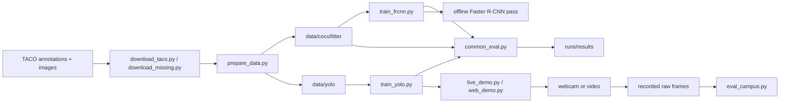

# Architecture

## Data flow

## Module responsibilities

| Module | Responsibility |
|---|---|
| `download_taco.py` | Recover TACO annotations and images from the public source. |
| `download_missing.py` | Fill images that failed during the first download pass. |
| `prepare_data.py` | Fold 60 categories into 6 superclasses, create the seed-42 split, resize, and export COCO + YOLO trees. |
| `data_utils.py` | Shared class list, COCO reader, and ground-truth conversion. |
| `models.py` | YOLO and Faster R-CNN loading plus prediction wrappers. |
| `train_yolo.py` | Fine-tune YOLO11n with deterministic settings. |
| `train_frcnn.py` | Fine-tune Faster R-CNN with frozen BatchNorm and validation-only selection. |
| `common_eval.py` | The only mAP implementation used by either model. |
| `run_eval.py` | Test-split evaluation and confidence sweep. |
| `benchmark.py` | Latency and throughput under one timing protocol. |
| `error_analysis.py` | TP / background / class / missed decomposition and size-stratified recall. |
| `levers.py` | Resolution, negative-mining, and capacity ablations. |
| `deploy_config.py` | Precision/recall cost of the demo configuration. |
| `live_demo.py` | Webcam or video inference, filters, HUD, snapshot, and raw recording. |
| `web_demo.py` | Browser MJPEG demo. |
| `web_upload.py` | Upload a clip, scan it, and play back the annotated result. |
| `eval_campus.py` | Out-of-domain evaluation in positive or negative mode. |
| `run_all.py` | Chain the reproducible pipeline with output sentinels. |

## Evaluation protocol

The comparison is only meaningful if both models receive the same problem:

1. One split, built once with seed 42, read by both models.
2. Both resize to 640 px. torchvision's short-side default of 800 px is
   overridden.
3. NMS IoU is 0.5 for both.
4. Both use `torchmetrics.MeanAveragePrecision` in COCO style. YOLO's built-in
   `val()` path is deliberately not used.
5. Checkpoints are selected on validation mAP only.
6. Timing uses batch 1, FP32, 10 discarded warm-up iterations, 100 timed
   iterations, and `torch.cuda.synchronize()` around the timed region.

## Weight provenance

| File | Provenance | Distribution |
|---|---|---|
| `runs/yolo/best.pt` | YOLO11n fine-tuned on the 1500-image TACO split at 640 px. | Committed to Git. |
| `runs/yolo_scene/best.pt` | YOLO11n further fine-tuned with campus negative frames for the demo. | Committed to Git. |
| `yolo11n.pt` | COCO-pretrained YOLO11n used for the person-veto head. | Committed to Git. |
| `runs/frcnn/best.pt` | Faster R-CNN MobileNetV3-Large FPN, 12-epoch reported schedule. | [GitHub Release asset](https://github.com/haodegaobai/litter-detection-yolo-frcnn/releases/tag/v1.0.0). |
| `runs/results/eval_frcnn_run1.json` | First Faster R-CNN schedule, retained for audit. | Committed as JSON only. |

## Important invariants

- No result in the README is typed by hand. The numbers come from
  `runs/results/*.json` and `runs/results/*.md`.
- The test split is never used for checkpoint selection.
- The demo filters are measured on the same test predictions, so the
  precision/recall trade-off is explicit.
- The negative-scene result is reported as false positives per frame, not as
  mAP, because those frames have no ground-truth boxes.
